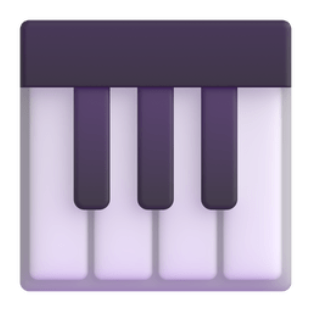
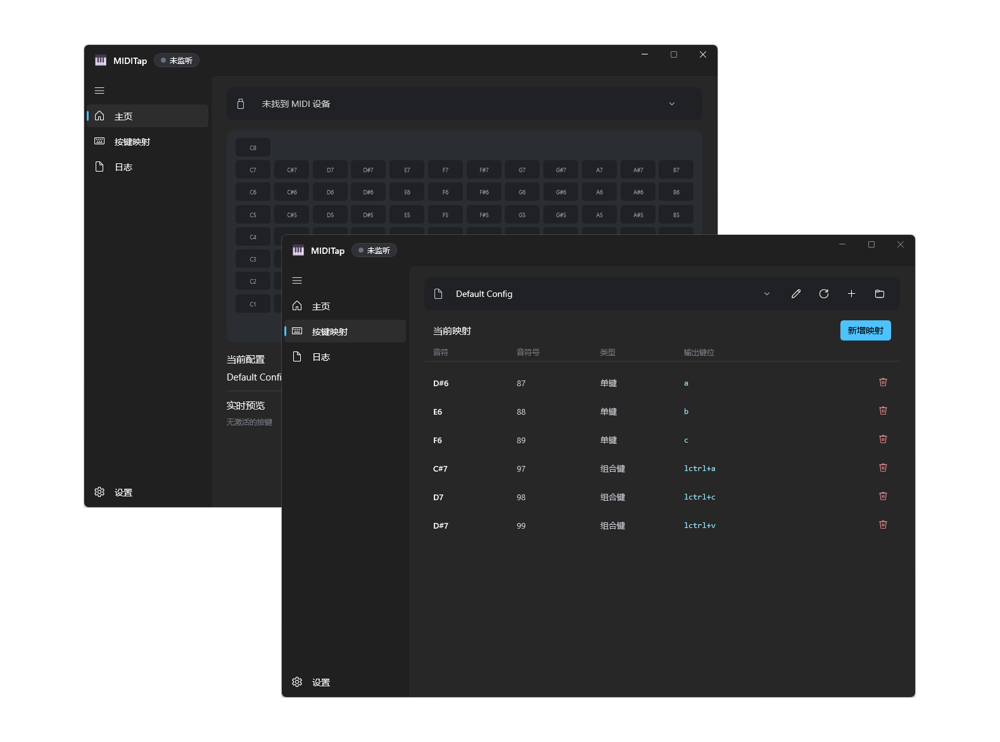

<div align="center">
  <h1 align="center">
    
    <br/>
    MIDITap
  </h1> 
  
  <p>
    一款基於 <a href="https://learn.microsoft.com/windows/apps/winui/">WinUI 3</a> 與 <a href="https://dotnet.microsoft.com/languages/csharp">C#</a> 開發，將 MIDI 輸入即時映射為鍵盤按鍵的輕量工具
  </p>

<!-- Badges -->

[](https://dotnet.microsoft.com/languages/csharp)
[](LICENSE)
<br>


[](https://github.com/MarchSnow-1/MIDITap/releases)

[English](README.md) | [简体中文](README_zh-Hans.md) | [繁體中文](README_zh-Hant.md)

</div>

---

<div align="center">
  
</div>

## 📖 使用須知

MIDITap 是一個呼叫 Windows 原生 API 的低延遲 MIDI → 鍵盤映射工具，使用 C# + WinUI 3 開發

如遇到問題，歡迎至 [Issues](../../issues) 回報

## ✨ 功能一覽

- 🎹 **原生映射**：呼叫 Windows API (`SendInput`) 即時將 MIDI 輸入轉換為鍵盤事件
- 🎵 **長按支援**：按住琴鍵時對應按鍵持續觸發，放開即釋放，手感自然
- 🔑 **完整按鍵支援**：字母、數字、功能鍵、方向鍵、小鍵盤、媒體鍵，一應俱全
- 🖥️ **人性化 UI**：原生 WinUI 3 美觀介面，內建視覺化一鍵綁定功能，便於上手
- 🎛️ **MIDIBridge（選用）**：在應用程式內一鍵下載 [MIDIBridge Client](https://github.com/MarchSnow-1/midibridge-client)，即可把遠端 `midibridge-server` 上的 MIDI 當作輸入來源（詳見下方的「擴充功能」章節）

## 🛠️ 環境要求

- Windows 10 1809+ 或任意版本的 Windows 11 (x64)
- 一台 MIDI 裝置

## 🚀 快速開始

1. 前往 [Release](../../releases) 頁面下載最新版本

2. 雙擊安裝程式並安裝

3. 開啟 MIDITap 程式，即可開始使用

- [這裡](/preset-configs/README_zh-CN.md) 提供了一些預設供參考或使用，可下載查看

## 📚 UI 介紹

### GUI 介面

應用程式採用側邊欄導航，共四頁：**首頁**、**按鍵映射**、**日誌**、**設定**

#### 首頁 — 裝置選擇與監聽

1. 在 **MIDI 裝置** 下拉選單中選擇裝置即可
   程式支援即時重新整理裝置清單，只要裝置可用就會自動開始監聽
   切換或拔除裝置則停止監聽，並放開所有被按住的按鍵
2. 按下 MIDI 琴鍵即可觸發映射的鍵盤輸出，首頁會即時標示目前啟用的音符
3. 點擊任意音符可直接開啟其對應的映射編輯器

#### 按鍵映射 — 映射管理

- **設定檔**：切換設定檔，選取即載入
- **重新整理**：重新載入設定檔清單
- **開啟資料夾**：開啟設定檔所在資料夾
- **重新命名**：重新命名設定檔
- **新增映射**：
  - **MIDI 音符**：點擊 **擷取音符** 後觸發你的 MIDI 裝置即可自動填入音符編號 (也可直接使用鍵盤輸入)
  - **輸出鍵位**：選擇擷取模式
    - **單鍵**：聚焦輸入框後按下一個按鍵 (a / enter / f1 等) 自動填入
    - **組合鍵**：聚焦輸入框後依序按下各個按鍵 (如 ctrl、shift、escape)，自動組合成組合鍵
  - 填寫完畢後點擊 **新增** 完成新增
- **目前映射**：顯示目前設定檔的全部映射，點擊垃圾桶圖示可刪除對應映射項

#### 日誌頁

展示完整的活動日誌

#### 設定 — 偏好

- **語言**：即時切換多種語言
- **外觀**：選擇應用程式使用的主題顏色
- **設定資料夾**：開啟設定所在資料夾
- **活動日誌**：自動把每筆活動日誌寫入本機檔案
  回報問題時可在日誌頁匯出本次執行的日誌記錄，並上傳打包好的壓縮檔
  故此功能 **預設關閉**
- **更新**：可開關「啟動時檢查更新」，發現新版本後會提示
  手動點擊更新後，應用程式會進行更新並重新啟動
- **代理**：僅用於更新檢查與下載，留空則跟隨 Windows 系統代理
  可填 HTTP 或 Socks5 代理 (如 `http://127.0.0.1:8080`、`socks5://127.0.0.1:1080`)
  需包含協定前綴；位址格式無效時介面會提示，並自動退回系統代理
- **MIDIBridge**：選用擴充功能，見下一個章節

## 🎛️ 擴充功能：MIDIBridge

### 它是什麼

MIDITap 包含對 [MIDIBridge Client](https://github.com/MarchSnow-1/midibridge-client) 的支援，可以將任意一台機器上連接的 MIDI 裝置透過網路傳輸，當作 MIDITap 的輸入來源

MIDIBridge 程式**不內建**於 MIDITap 的安裝套件或更新套件內，可依需求在程式內從 [MIDIBridge Client](https://github.com/MarchSnow-1/midibridge-client) 儲存庫一鍵下載，MIDITap 不代為散布原始程式

首頁的裝置下拉選單常駐一個 MIDIBridge 項目，位於最底部

未安裝時，選取它會彈出下載與安裝的確認框

在設定頁可查看目前執行狀態、版本與協定版本，並支援在 MIDITap 內檢查 MIDIBridge 是否有更新

檢查 MIDIBridge 更新只在 MIDITap 本身為最新版時才進行；當 MIDITap 有新版本時無法檢查，請先更新 MIDITap 本體再行嘗試

檢查到新版本時會彈出與本體更新相同的視窗，顯示版本對照與更新內容，確認後再下載安裝

> [!NOTE]
> MIDITap 僅提供 MIDIBridge Client 端的相關支援
>
> 使用 MIDIBridge 相關功能仍需自行架設對應的 MIDIBridge Server
>
> 詳情請參考：[MIDIBridge](https://github.com/MarchSnow-1/midibridge) 的相關介紹及架設教學

## ✏️ 手動編寫設定檔

設定檔以 JSON5 格式存放在 `MIDITap.exe` 旁的 `config/` 資料夾 (支援註解與尾隨逗號)

若想不透過介面手寫整套映射，格式說明與**完整鍵名清單**見 [preset-configs](/preset-configs/README_zh-CN.md#️-手动编写配置格式)

## 📦 從原始碼建置

> [!TIP]
> 希望為專案貢獻程式碼？
> 推薦的開發、驗證流程詳見 [開發流程](docs/DEVELOPMENT_zh-CN.md)

### 環境要求

- [.NET SDK 10.0+](https://dotnet.microsoft.com/download)
- Windows 10 1809+ / Windows 11
- Git

### 步驟

```bash
# 1. 複製儲存庫
git clone https://github.com/MarchSnow-1/MIDITap.git
cd MIDITap

# 2. 執行單元測試
dotnet test MIDITap.sln

# 3. 以 Debug 模式執行應用程式 (會自動建置)
dotnet run --project src/MIDITap.App/MIDITap.App.csproj -c Debug
```

執行中的應用程式會鎖定 `MIDITap.exe`，重新建置前請先關閉它

## ⚠️ 免責聲明

- **本作品按「原樣」提供，且專案作者／貢獻者不提供任何明示或暗示的聲明或保證**
- 本工具透過模擬鍵盤輸入運作，與 AutoHotkey 等工具類似
- MIDITap 面向通用的 MIDI → 按鍵映射場景，並非專為遊戲開發
- 雖然目前沒有因使用本工具而導致遊戲帳號停權的已知案例，但部分嚴格的防作弊系統可能對第三方輸入軟體敏感
- 因此，**使用前請自行了解相關軟體的使用者協定／使用條款，下載即表示接受全部風險**
